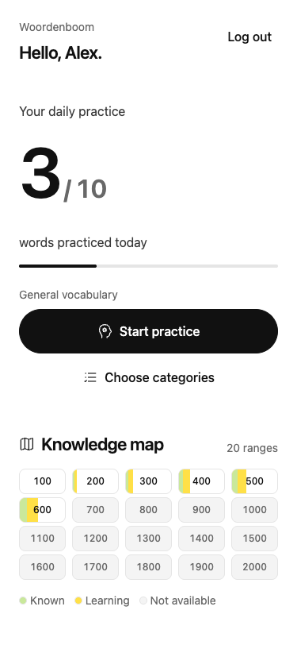
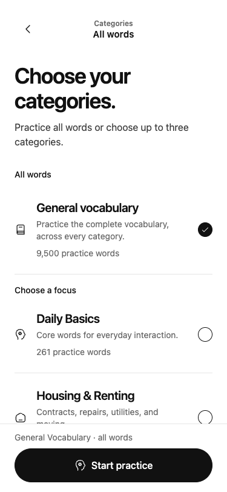
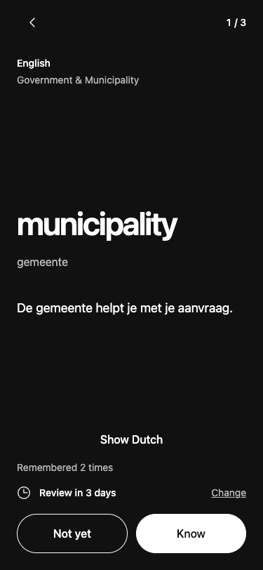
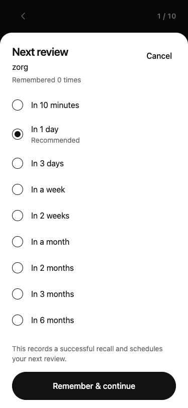

# Category, icon and motion delivery

Implemented locally on October 1, 2026 in the existing Expo app and Docker API.
The API is running on port 8080 and the Expo preview on 8081. Migration 16 and the
category overlay are applied to the local database. No production deployment or
app-store release was made.

## Result

General Vocabulary now contains all 9,500 eligible words. Specific categories
filter the same collection; overlapping selections produce one card per word.
The selector separates General from a custom mix, with up to three specific
categories. Its preview endpoint returns six words and the exact unique count.
The dashboard still starts General practice directly.

1,763 words have a specific category, up from 473. The overlay adds 1,372
memberships and keeps all existing assignments. Selected examples:

| Category | Before | After |
| --- | ---: | ---: |
| Healthcare | 11 | 468 |
| Supermarket & Food | 16 | 248 |
| Engineering & Technical | 11 | 136 |
| Public Transport | 15 | 87 |
| Software & IT | 5 | 57 |
| Work & Office | 8 | 36 |

Counts overlap. General includes both categorized and uncategorized words.
The 7,737 remaining words have no specific category. All new classifications
are drafts awaiting independent language review. The 500-word pilot, corrected
misclassifications, rule evidence and full counts are recorded in
[the category release](../../../data/content/categories-v1/README.md).

Category lessons select the relevant paired translation and Dutch definition.
Newly selected senses omit unverified example sentences. Original release
content and existing session snapshots remain intact. Review timing stays on
word IDs across General, categories and map entry points. Progress counts use
memberships rather than the last category where the word was studied.

Iconoir replaces text-glyph icons through the shared semantic registry. Actions,
category rows, navigation, the map heading, review timing and saved completion
now use regular line icons. Text actions remain labeled; decorative SVGs are
hidden from accessibility output. MIT attribution is included in the app.

Motion uses short opacity changes for presses, selection checks, study content,
sheet entry and completion. Progress fills animate only when values change.
Words keep their existing vertical anchor. A shared Reduce Motion subscription
updates all these components while the app is open.

## Verification

- Python content and classifier suite: 15 tests passed. Reimport was idempotent,
  with zero inserted, updated or deleted memberships on an unchanged release.
- Go suite passed against the migrated local database. Added regressions cover
  General's 9,500-word pool, the original 9,027-word legacy pool, category-specific
  pupil meanings, deduplicated unions, bounded previews, shared progress and
  future reviews remaining excluded after switching category.
- Mobile lint and TypeScript checks passed.
- iOS and Android production bundle exports succeeded. Hermes bundles are
  2,695,037 and 3,040,314 bytes, respectively. The earlier definition build was
  2,454,711 and 2,799,926 bytes, an increase of about 240 KB per platform.
  Explicit per-icon files avoid bundling Iconoir's entire catalog.
- [Layout and interaction checks](qa-results.json) passed at 320, 375, 414 and
  768 pixels, plus a 320 by 568 short screen. Verified stable word position within
  one pixel, compact map pills with 44-point targets, General/mix exclusivity,
  unique preview counts, reduced-motion word transitions, save failure/retry,
  duplicate taps, pending-save navigation, completion, restart and empty states.
- [Live category checks](live-category-checks.json) matched every database
  category count. Healthcare plus Food produced 710 distinct words, compared
  with 716 summed memberships. Practice returned ten unique cards and saved
  progress successfully.
- The live vocabulary checks confirmed 95 ranges, 9,500 translated words, and
  30 distinct practice words across three consecutive stacks.
- Live definition checks passed for hidden-before-flip definitions, paired
  meanings, scrolling, missing-definition fallback and saved answers.
- Live review-timing checks passed for recommended, week, month and year timing,
  cancel, pause/resume, duplicate answers, ten-minute retry, failed-save retry,
  short-screen scrolling, Escape dismissal and no premature future reviews.

Screenshots were visually inspected for the dashboard, narrow category selector,
black study card, live mixed preview and timing sheet. These checks use Expo web
and isolated accounts removed after each run. Fixture screenshots are labeled
by route/width; `live-*` screenshots use the real local API.

Native VoiceOver/TalkBack, Dynamic Type, device safe areas, low-end Android
responsiveness and Expo Go/development-build behavior remain unverified.
Successful native exports establish compilation, not device interaction quality.

## Screenshots

