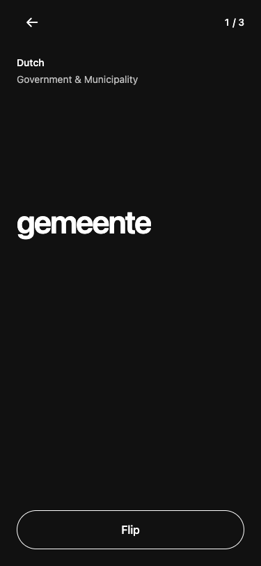
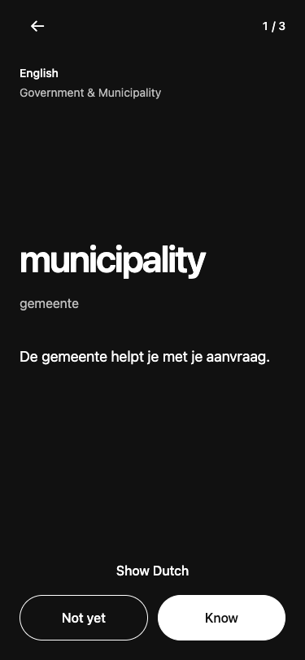
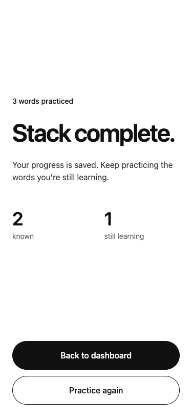

# Monochrome cards and stable word placement

The app now uses black, white and neutral gray. Only knowledge-map progress retains green and yellow. Study cards are black on both sides, with white text and controls. Completion states return to the white app canvas.

The word remains left-aligned at the same vertical anchor, slightly above the midpoint. The original layout centered a variable-height content group. Adding the translation and examples made that group taller and moved the word upward. The revised layout anchors it from the top, reserves metadata and control space, and allows examples to flow below it. Each Dutch/English pair shares a font size.

A 160 ms fade introduces the word and examples. It changes opacity only. Reduce Motion disables it, and rapidly changing cards cancels the previous animation. Text remains scrollable on short screens or with large content.

| Dutch | English |
| --- | --- |
|  |  |

## Verification

- Word positions differ by less than 1 pixel when flipping and advancing at 320, 375, 414 and 768 pixels wide.
- Both normal-motion fade and reduced-motion instant reveal passed browser tests.
- Existing tests for completion, empty states, save failure/retry, duplicate taps, navigation, category limits and progress refresh pass.
- Lint and TypeScript pass. Native bundle exports are checked separately from device behavior.
- Screenshots use the actual Expo web app and isolated API fixtures. Native safe areas, status-bar contrast and the animation on iOS/Android hardware still require a device check.

The recommendation to keep a stable anchor is specific to this repeated flashcard task. Reduced-motion handling follows [W3C interaction-animation guidance](https://www.w3.org/WAI/WCAG22/Understanding/animation-from-interactions.html). Shared rules are in [design.md](../../../design.md).
