# Mobile UX and style review

Update: the subsequent [monochrome refinement](monochrome/review.md) replaces the yellow study and lime completion palette below. This report retains the original review and screenshots.

Reviewed and implemented on 29 September 2026. The goal is a consistent, simple mobile app led by typography, spacing and readable content.

The old dashboard gave nearly every section the same rounded container and heavy heading. The study reveal used a separate black visual theme. Sign-in and profile setup used a third cream palette. The revised app uses white pages, yellow study cards and a lime completion state, with shared text styles and controls.

## Evidence and scope

The supplied dashboard screenshot is the visual baseline. Other original-screen findings below come from the existing implementation, not an observed native session. Browser control timed out, and no iOS simulator was available. With user permission, verification used the actual Expo app in Playwright at 320, 375, 414 and 768-point widths, with isolated API fixtures. No account progress or emails were changed.

The fixture captures illustrate layout and behavior; their counts are test data. They do not report the user's learning progress. The source reference is inspiration, not an instruction to add unsupported audio or fabricated definitions.

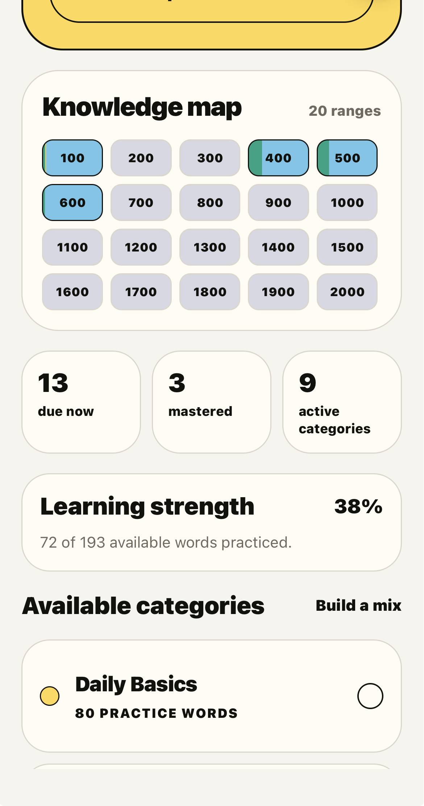

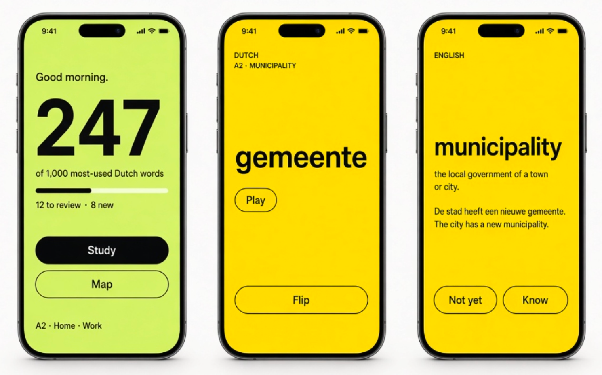

## Findings and changes

| Priority | Evidence | Problem | Implemented change |
| --- | --- | --- | --- |
| High | Dashboard screenshot | Large rounded boxes, heavy metadata and competing headings obscure the main action. | White canvas, unboxed statistics and map, divided category rows, one clear Study action. |
| High | Original `FullscreenWordCard.tsx` | Translation is visible on the front. Flipping switches to black, repeats the translation, and introduces nonfunctional meaning/usage tabs and icon-only answers. | Dutch first, English after reveal, yellow on both sides, plain examples, labeled Not yet / Know controls. |
| High | Original review and range routes | A loaded array of zero words satisfies the completion condition. | Explicit empty states with a route back to categories or map. |
| High | Original range route and shared answer behavior | Delayed advancement can outlive the screen; state-only submit guards allow a rapid second event before rerender. | Shared answer handling with a synchronous lock and generation checks. Removed delayed advancement. Errors preserve the current word. |
| High | Original completion layout | Padding on React Native's built-in SafeAreaView is unreliable on iOS, and fixed layout has no scroll recovery. | Supported safe-area component, explicit inner spacing, scrollable completion content and reachable actions. Native insets still need device verification. |
| High | Navigation test and route code | Authentication restoration redirects away from requested routes. Returning to an existing dashboard/map does not reload progress. | Keep the requested route through auth restoration; refresh dashboard/map on focus; dismiss to the existing destination on completion. |
| Medium | Original categories flow | The start action is below a long list. Dashboard category rows resemble checkboxes but only navigate. Unavailable categories expose implementation language. | Persistent Study action, explicit selection limit, real checkbox semantics only on selection rows, category preselection from dashboard, plain Coming soon copy. |
| Medium | Original preview requests | Earlier category preview responses can overwrite the latest selection. | Ignore obsolete preview responses and clear previews when selections change. |
| Medium | Original map and rendered preview | Small cells, unexplained colors, fixed five-column grid. | 48-point targets, adaptive four/five-column layout, legend and range/status accessibility labels. |
| Medium | Original login/profile routes | A separate palette and form-box style; no way to correct an email after requesting a code. | Shared typography, unboxed forms, labeled fields, resend and change-email actions, code autofill metadata. |
| Medium | 320px word capture | Long Dutch compound splits awkwardly at the fixed display size. | Width- and word-length-aware display sizing, with wrapping retained for longer content and native text scaling. |
| Medium | Browser checkbox inspection | Visible selection did not expose its checked state to web accessibility APIs. | Added explicit checked/disabled ARIA state alongside native accessibility state. |

## Screen-by-screen result

1. **Sign-in and code verification: improved.** Consistent open form layout, one primary action, email correction and resend. Real email delivery was not exercised.

   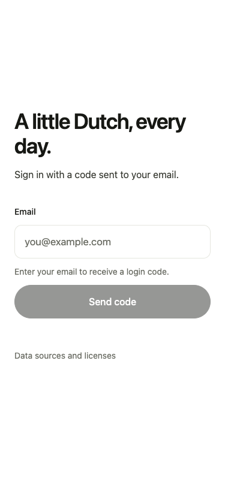
   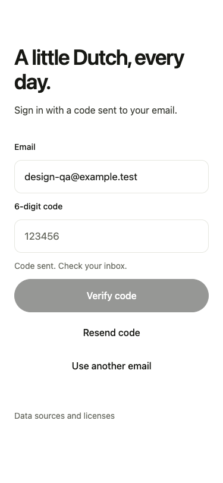

2. **Profile setup: improved.** Shared form styles and selectable age controls. Continue matches its actual destination. Native keyboard avoidance is configured but needs device testing.

   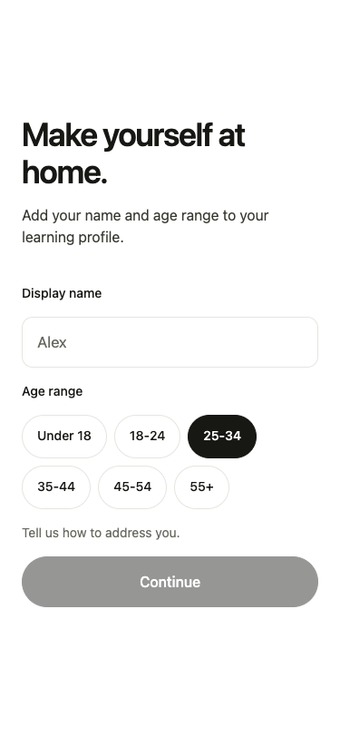

3. **Dashboard: improved.** One typographic daily count, a prominent Study action, unboxed sections, and refreshed data after a stack.

   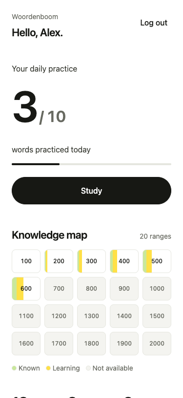
   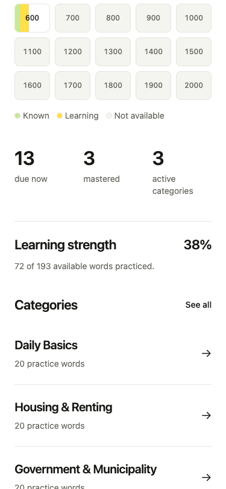

4. **Categories: improved.** Clear selection rows, persistent action, three-category limit, and preselection when entering from a dashboard category.

   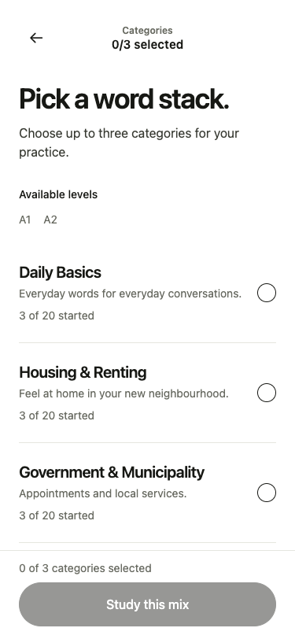

5. **Study front and reveal: improved.** One stable visual language. Translation stays hidden until Flip; the two rating actions use words. Long content is scrollable, without an overlapping absolute-positioned dock.

   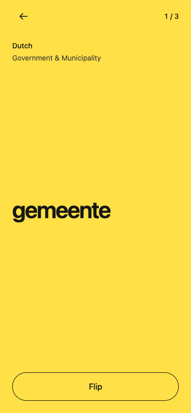
   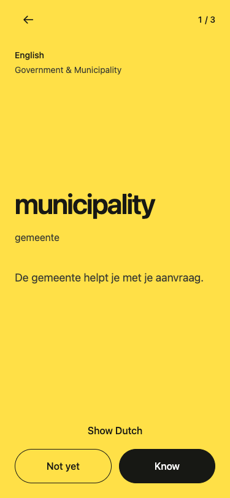
   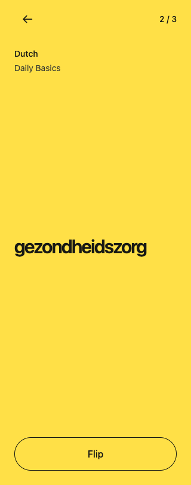

6. **Stack completion: fixed in browser tests.** Accurate known/learning split, restart reset, return to refreshed dashboard, and scroll recovery on short screens.

   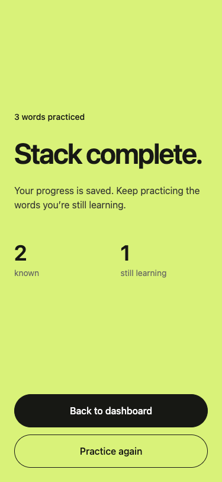
   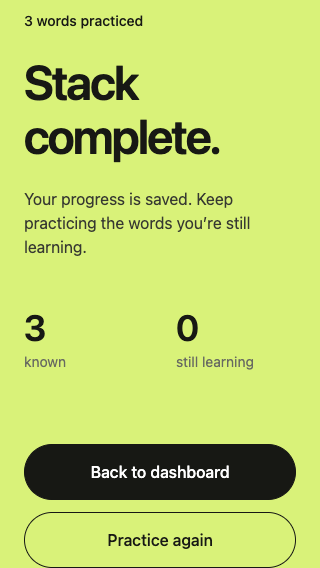

7. **Knowledge map and range: improved.** Responsive labeled ranges, shared study card, empty-range handling and refreshed map after completion.

   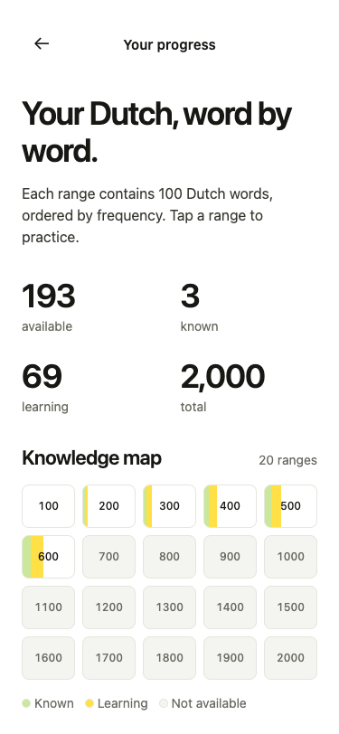
   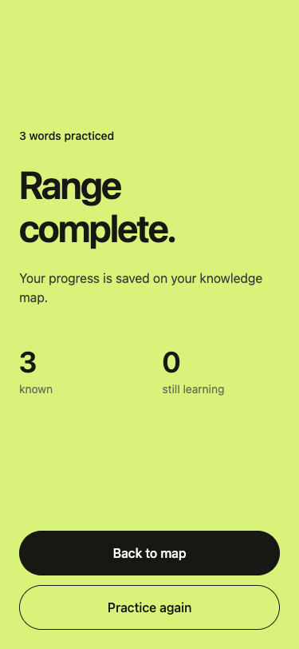

8. **Errors and empty states: improved.** Retry preserves context; a failed answer remains on the current card. Empty results do not claim success.

   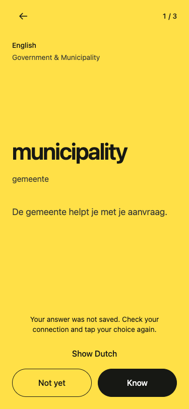
   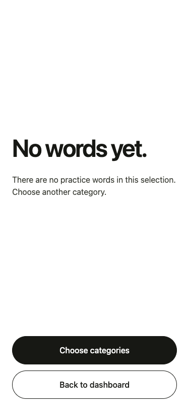
   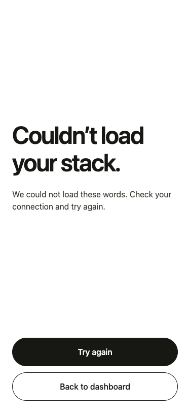

9. **Data sources and licenses: aligned.** Shared navigation, typography and white canvas. Original license text retained.

   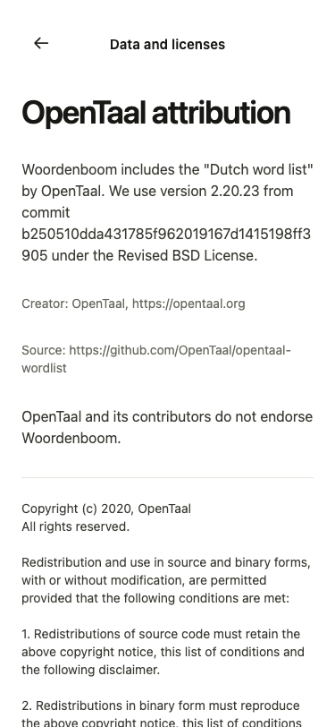

## Verification and remaining limits

The repeatable test is `apps/mobile/scripts/design-qa.cjs`. It uses Playwright supplied through `PLAYWRIGHT_PATH`, optional `CHROME_PATH`, and an Expo web server at `QA_BASE_URL` or port 8081. Every API request to port 8080 is intercepted with fixtures.

Checks include layout overflow, hidden translations, known/learning counts, duplicate answer taps, save failure and retry, restart, empty session and range responses, load retry, category preselection and limits, route restoration, completion navigation, dashboard/map refresh, and navigation while a save is pending. Captures cover common mobile widths and a short 320 × 568 viewport. Results are saved in `qa-results.json`.

`npm run lint` and `npx tsc --noEmit` passed. Expo exports for both iOS and Android completed successfully. Expo-compatible `react-dom` and `react-native-web` dependencies were added to enable the existing web preview command.

Native device safe areas, VoiceOver/TalkBack, Dynamic Type, software keyboard behavior, and live API integration remain unverified. A native bundle export confirms compilation only. The implementation retains font scaling and scroll recovery; this is not a claim of full accessibility compliance.

The shared style rules are in [design.md](../../design.md), backed by `apps/mobile/src/lib/theme.ts`. Continue using those tokens rather than introducing screen-specific colors or card treatments.

Implementation references: [Expo 57 safe-area documentation](https://docs.expo.dev/versions/v57.0.0/sdk/safe-area-context/) and [Expo Router API](https://docs.expo.dev/versions/v57.0.0/sdk/router/).
